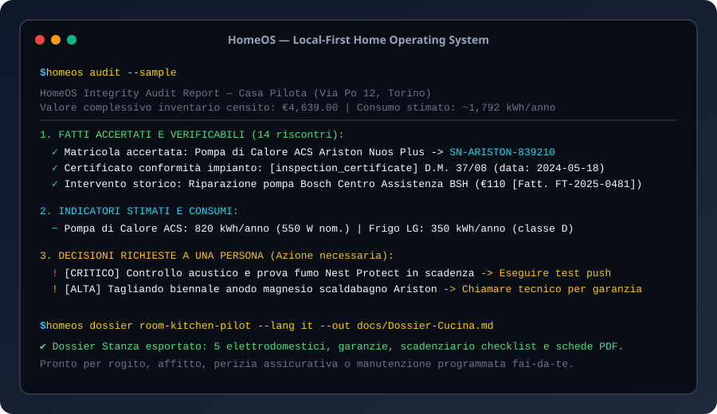

# HomeOS — Il Sistema Operativo Locale e Libretto Digitale della Casa

[Italiano](README.it.md) · [English](README.md) · [Architettura](docs/ARCHITECTURE.md) · [Checklist di Lancio](docs/LAUNCH.md) · [Changelog](CHANGELOG.md)

[](LICENSE)
[](https://github.com/MRJonam91/HomeOS/actions/workflows/ci.yml)
[](package.json)
[](package.json)
[](https://github.com/sponsors/MRJonam91)



**HomeOS** è un sistema operativo per l'abitazione e libretto digitale d'immobile indipendente, local-first e a zero telemetria. Collega l'inventario delle stanze, le schede tecniche, i manuali PDF, i numeri di matricola, il ciclo di vita delle garanzie e gli scadenziari delle manutenzioni ordinarie e straordinarie in un registro JSON deterministico, esportando dossier completi in Markdown per inquilini, rogiti notarili o perizie assicurative.

---

## 🎯 Il Problema

Le informazioni relative alla casa sono storicamente frammentate e vulnerabili:
- **Documentazione dispersa o persa**: Manuali d'uso, scontrini d'acquisto termici che sbiadiscono e dichiarazioni di conformità (D.M. 37/08) finiscono sparsi in cassetti o allegati email irrecuperabili.
- **Manutenzioni dimenticate ed extra-costi**: Gli anodi di magnesio dei bollitori a pompa di calore si consumano corrodendo il serbatoio; i condensatori dei frigoriferi si ostruiscono di polvere (+20% sui consumi elettrici); i rilevatori fumo/CO superano la scadenza dei 10 anni della cella chimica.
- **Garanzie non sfruttate**: I termini per richiedere riparazioni gratuite del produttore scadono senza che il proprietario si sia accorto del difetto in tempo.
- **Lock-in cloud e violazione della privacy**: Le app commerciali raccolgono i dati interni dell'abitazione su server esteri con modelli a canone, diventando inutilizzabili in assenza di connessione.

---

## 💡 La Soluzione: HomeOS

HomeOS fornisce una Single Source of Truth locale, affidabile e verificabile:

1. **Modello Immobile-Stanza-Oggetto**: Albero strutturato per mappare proprietà, locali, elettrodomestici, impianti termoidraulici e dotazioni di sicurezza.
2. **Registro Garanzie Attivo**: Calcolo in tempo reale dello stato (`attiva`, `in scadenza`, `scaduta`, `a vita`), giorni residui, riferimenti polizza e contatti diretti dell'assistenza autorizzata.
3. **Scadenziario Manutenzioni e Costi**: Tracciamento delle routine programmate con indicazione fai-da-te o tecnico specializzato, checklist operative e stima economica preventiva.
4. **Audit di Integrità Dati a 3 Livelli**:
   - **Fatti Osservati e Accertati**: Dati con riscontro certo (matricole verificate, documenti PDF collegati, scontrini/fatture registrate).
   - **Indicatori Stimati**: Potenza nominale, consumo teorico annuo (kWh/anno) e valore economico di sostituzione.
   - **Decisioni Umane Richieste**: Allarmi chiari e prioritari per garanzie in scadenza entro 30 giorni, ispezioni di sicurezza critiche e controlli tecnici obbligatori.
5. **Esportazione Dossier Stanza Bilingue**: Creazione istantanea con un comando di fascicoli completi in formato Markdown (IT/EN), ideali per contratti d'affitto, passaggio di proprietà o periti assicurativi.
6. **Zero Dipendenze Runtime & Core < 1.500 LOC**: Scritto in moderno TypeScript sfruttando esclusivamente le API native di Node.js, con un'architettura essenziale pensata per essere padroneggiata in un'ora.

---

## 🚀 Avvio rapido​‌​​‌‌​‌​‌​‌​​‌​​‌​​‌​‌​​​‌‌‌​​‌​​‌‌​​​‌​​‌​‌‌​‌​‌‌​‌​​​​‌‌​‌‌‌‌​‌‌​‌‌​‌​‌‌​​‌​‌​‌‌​‌‌‌‌​‌‌‌​​‌‌​​‌​‌‌​‌​‌‌​​‌‌​​​‌‌‌​​​​‌‌​​​‌‌​​‌‌​​‌​​‌‌​​​‌​​​‌‌​​​‌

Esegui immediatamente con `npx` oppure clona il repository:

```bash
# 1. Inizializza un nuovo registro con il dataset pilota della cucina
npx homeos init --sample

# 2. Visualizza le manutenzioni in arrivo o scadute
npx homeos schedule --days 90

# 3. Verifica la copertura delle garanzie di tutti gli apparati
npx homeos warranties

# 4. Esegui l'audit di integrità a tre livelli (fatti, stime, decisioni)
npx homeos audit

# 5. Esporta il dossier formattato in Markdown per la cucina
npx homeos dossier room-kitchen-pilot --lang it --out Dossier-Cucina.md
```

### Installazione Locale

```bash
npm install -g homeos
# oppure da sorgente:
git clone https://github.com/MRJonam91/HomeOS.git
cd HomeOS
npm install
npm test
npm run build
```

---

## 📖 Comandi CLI

| Comando | Descrizione |
|---|---|
| `homeos init [--sample]` | Inizializza il registro (con opzione dati pilota per test immediato) |
| `homeos room list` | Elenca le stanze registrate e il numero di apparecchi |
| `homeos room add <nome>` | Aggiunge un nuovo locale con piano e categoria |
| `homeos item add <roomId> <nome>` | Registra un apparecchio con marca, modello, matricola e prezzo |
| `homeos list [--room <id>]` | Mostra l'inventario completo con stato delle garanzie |
| `homeos search <testo>` | Cerca tra marche, matricole, modelli, tag e manuali allegati |
| `homeos schedule [--days <n>]` | Mostra il calendario manutenzioni e il riepilogo costi stimati |
| `homeos warranties [--days <n>]` | Ispeziona le garanzie evidenziando coperture attive e scadenze |
| `homeos audit` | Genera il report di integrità (fatti accertati vs stime vs decisioni) |
| `homeos dossier [roomId] [--lang it\|en]` | Esporta il fascicolo completo in Markdown (stanza o intera casa) |
| `homeos task done <itemId> <taskId>` | Registra intervento eseguito e ricalcola la scadenza futura |
| `homeos task add <itemId> <titolo>` | Pianifica una nuova manutenzione periodica con frequenza e stima costi |
| `homeos doc add <itemId> <titolo> <tipo>` | Collega libretti d'uso, scontrini o certificati di conformità |
| `homeos export --ical <file.ics>` | Esporta il calendario manutenzioni in formato iCalendar (.ics) |
| `homeos export --homeassistant <file.yaml>` | Genera il pacchetto sensori e automazioni per Home Assistant |
| `homeos export --html <file.html>` | Genera la dashboard HTML interattiva e stampabile in PDF |
| `homeos export --csv-inventory <file.csv>` | Esporta l'inventario in formato CSV per fogli di calcolo |
| `homeos export --backup <file.json>` | Salva uno snapshot di backup con checksum SHA-256 |
| `homeos diff <fileA> [fileB]` | Confronta due registri evidenziando aggiunte, rimozioni e modifiche |

---

## 🏗️ Architettura e Confini

```
+-------------------------------------------------------------+
|                         CLI / UI                            |
|             (homeos init / list / search / audit)           |
+-------------------------------------------------------------+
                              |
+-------------------------------------------------------------+
|                         Core API                            |
|  +--------------------+  +-------------------------------+  |
|  |     Inventory      |  |           Warranty            |  |
|  | (Rooms & Items)    |  | (Lifecycle & Alert Engine)    |  |
|  +--------------------+  +-------------------------------+  |
|  +--------------------+  +-------------------------------+  |
|  |    Maintenance     |  |             Audit             |  |
|  | (Schedule & Costs) |  | (Tripartite Integrity Engine) |  |
|  +--------------------+  +-------------------------------+  |
|  +--------------------+  +-------------------------------+  |
|  |      Exporter      |  |           Fixtures            |  |
|  | (Markdown Dossier) |  |  (Synthetic Master Kitchen)   |  |
|  +--------------------+  +-------------------------------+  |
+-------------------------------------------------------------+
                              |
+-------------------------------------------------------------+
|                 Local JSON Storage Engine                   |
|               (homeos-ledger.json / schemas)                |
+-------------------------------------------------------------+
```

### Confini e Competenze Professionali
- HomeOS è uno strumento di catalogazione, custodia documentale e scadenziario preventivo.
- Le certificazioni energetiche (APE), i calcoli termotecnici di legge e le diagnosi di guasto sugli impianti richiedono professionisti abilitati e strumentazione certificata.

Per i dettagli sui pattern di codice e le linee guida di estensione, consulta [docs/ARCHITECTURE.md](docs/ARCHITECTURE.md).

---

## 💖 Supporto e Donazioni

HomeOS è un progetto open source indipendente dedicato alla sovranità tecnologica e agli standard aperti. Se HomeOS ti è utile per gestire casa o ti ha fatto risparmiare tempo e interventi di riparazione, puoi sostenere lo sviluppo continuativo:

- **GitHub Sponsors**: [github.com/sponsors/MRJonam91](https://github.com/sponsors/MRJonam91)
- **Ko-fi**: [ko-fi.com/mrjonam](https://ko-fi.com/mrjonam)
- **Buy Me a Coffee**: [buymeacoffee.com/mrjonam](https://buymeacoffee.com/mrjonam)
- **PayPal**: [paypal.me/manorollo](https://paypal.me/manorollo)

---

## 📜 Licenza e Governance

- **Codice Sorgente**: [GNU Affero General Public License v3.0 (AGPL-3.0-only)](LICENSE).
- **Licenza Commerciale**: Disponibile in [COMMERCIAL-LICENSE.md](COMMERCIAL-LICENSE.md) per operatori prop-tech, fornitori di domotica e soluzioni commerciali chiuse.
- **Contributi**: Richiedono la sottoscrizione del [Contributor License Agreement (CLA)](CLA.md).
- **Documentazione**: CC BY-SA 4.0.
- **Dataset Sintetici di Prova**: CC0 1.0 Universal (Pubblico Dominio).
- Quadro completo di attribuzione: [LICENSING.md](LICENSING.md).

Copyright (C) 2026 Manoj Rollo ([@MRJonam91](https://github.com/MRJonam91)).
