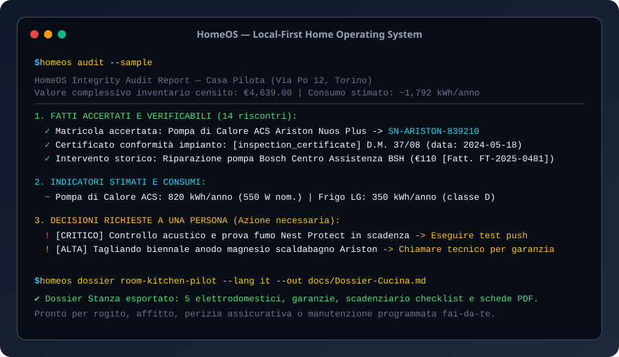

# HomeOS — Local-First Home Operating System & Digital Binder

[Italiano](README.it.md) · [English](README.md) · [Architecture](docs/ARCHITECTURE.md) · [Launch Checklist](docs/LAUNCH.md) · [Changelog](CHANGELOG.md)

[](LICENSE)
[](https://github.com/MRJonam91/HomeOS/actions/workflows/ci.yml)
[](package.json)
[](package.json)
[](https://github.com/sponsors/MRJonam91)



**HomeOS** is an independent, zero-telemetry, local-first home operating system and digital binder. It connects room inventories, appliance manuals, serial numbers, warranty lifecycles, and recurring maintenance routines into an inspectable, deterministic JSON ledger and exports structured Markdown dossiers for tenants, buyers, and insurance audits.

---

## 🎯 The Problem

Household information is notoriously fractured and fragile:
- **Scattered & Lost Documentation**: Appliance manuals, warranty receipts, and electrical/plumbing certificates sit in random drawers or deleted email threads.
- **Forgotten Maintenance & Preventative Care**: Anodes in heat pump boilers degrade unnoticed, refrigerator coils choke on dust (wasting 15–20% electricity), and smoke detector sensors expire past their 10-year electrochemical lifespan.
- **Unclaimed Warranties**: Manufacturers' warranty deadlines lapse before owners realize an issue is eligible for free factory repair.
- **Cloud Lock-in & Surveillance**: Proprietary prop-tech apps harvest private household data, require cloud subscriptions, or shut down when servers go dark.

---

## 💡 The Solution: HomeOS

HomeOS provides a private, verifiable single source of truth for residential property:

1. **Property-Room-Item Model**: Hierarchical property tree mapping rooms, appliances, HVAC systems, and safety equipment.
2. **Warranty Guardian**: Real-time lifecycle tracking (`active`, `expiring_soon`, `expired`, `lifetime`), remaining day calculations, policy numbers, and support contacts.
3. **Maintenance Scheduler & Cost Forecasting**: Tracks recurring routines with DIY vs contractor indicators, step-by-step checklists, overdue warnings, and cost projections.
4. **Three-Tier Integrity Audit**:
   - **Observed Verifiable Facts**: Strict records backed by receipts, verified serials, compliance certificates, and dated intervention logs.
   - **Estimated Indicators**: Theoretical power draw (kWh/yr), standby power, and equipment replacement values.
   - **Required Human Decisions**: Actionable alerts for warranties expiring within 30 days, urgent safety checks, and overdue technician servicing.
5. **Bilingual Room Dossier Export**: One-command generation of comprehensive Markdown binders in Italian or English, ready for property sale, tenancy handover, or insurance claims.
6. **Zero Runtime Dependencies & < 1,500 LOC Core**: Pure modern TypeScript utilizing Node.js native primitives with an ultra-light core designed to be mastered in under an hour.

---

## 🚀 Quick start​‌​​‌‌​‌​‌​‌​​‌​​‌​​‌​‌​​​‌‌‌​​‌​​‌‌​​​‌​​‌​‌‌​‌​‌‌​‌​​​​‌‌​‌‌‌‌​‌‌​‌‌​‌​‌‌​​‌​‌​‌‌​‌‌‌‌​‌‌‌​​‌‌​​‌​‌‌​‌​‌‌​​‌‌​​​‌‌‌​​​​‌‌​​​‌‌​​‌‌​​‌​​‌‌​​​‌​​​‌‌​​​‌

Run instantly with `npx` or clone the repository:

```bash
# 1. Initialize a new ledger seeded with the pilot kitchen dataset
npx homeos init --sample

# 2. View upcoming maintenance routines and overdue alerts
npx homeos schedule --days 90

# 3. Audit warranty coverage across all registered items
npx homeos warranties

# 4. Run the three-tier integrity audit
npx homeos audit

# 5. Export a structured Markdown binder for the kitchen
npx homeos dossier room-kitchen-pilot --lang en --out Kitchen-Binder.md
```

### Installation

```bash
npm install -g homeos
# or clone locally:
git clone https://github.com/MRJonam91/HomeOS.git
cd HomeOS
npm install
npm test
npm run build
```

---

## 📖 CLI Reference

| Command | Description |
|---|---|
| `homeos init [--sample]` | Initialize ledger (optionally seeded with synthetic pilot home) |
| `homeos room list` | List registered rooms and item counts |
| `homeos room add <name>` | Create a new room with category and floor options |
| `homeos item add <roomId> <name>` | Register an appliance or asset with brand, model, serial, and price |
| `homeos list [--room <id>]` | List inventory items with status summary |
| `homeos search <query>` | Search items across serial numbers, models, tags, and document titles |
| `homeos schedule [--days <n>]` | View upcoming and overdue maintenance tasks and estimated costs |
| `homeos warranties [--days <n>]` | Audit warranty coverages and flag expiring guarantees |
| `homeos audit` | Run tripartite data integrity report (facts vs estimates vs decisions) |
| `homeos dossier [roomId] [--lang it\|en]` | Export Markdown house binder (room or whole-house) |
| `homeos task done <itemId> <taskId>` | Mark maintenance task as completed and advance due date |
| `homeos task add <itemId> <title>` | Add routine maintenance task with frequency and checklist |
| `homeos doc add <itemId> <title> <type>` | Attach manuals, receipts, or inspection certificates |
| `homeos export --ical <file.ics>` | Export maintenance routines to iCalendar (.ics) feed |
| `homeos export --homeassistant <file.yaml>` | Generate Home Assistant YAML sensor & alert package |
| `homeos export --html <file.html>` | Export self-contained, printable HTML dashboard |
| `homeos export --csv-inventory <file.csv>` | Export full property inventory to spreadsheet CSV |
| `homeos export --backup <file.json>` | Create tamper-evident cryptographic SHA-256 backup |
| `homeos diff <fileA> [fileB]` | Compare two ledgers and summarize changes |

---

## 🏗️ Architecture & Boundaries

```
+-------------------------------------------------------------+
|                         CLI / UI                            |
|             (homeos init / list / search / audit)           |
+-------------------------------------------------------------+
                              |
+-------------------------------------------------------------+
|                         Core API                            |
|  +--------------------+  +-------------------------------+  |
|  |     Inventory      |  |           Warranty            |  |
|  | (Rooms & Items)    |  | (Lifecycle & Alert Engine)    |  |
|  +--------------------+  +-------------------------------+  |
|  +--------------------+  +-------------------------------+  |
|  |    Maintenance     |  |             Audit             |  |
|  | (Schedule & Costs) |  | (Tripartite Integrity Engine) |  |
|  +--------------------+  +-------------------------------+  |
|  +--------------------+  +-------------------------------+  |
|  |      Exporter      |  |           Fixtures            |  |
|  | (Markdown Dossier) |  |  (Synthetic Master Kitchen)   |  |
|  +--------------------+  +-------------------------------+  |
+-------------------------------------------------------------+
                              |
+-------------------------------------------------------------+
|                 Local JSON Storage Engine                   |
|               (homeos-ledger.json / schemas)                |
+-------------------------------------------------------------+
```

### Scope & Professional Boundaries
- HomeOS is an organizational ledger and preventative maintenance engine.
- Building energy performance simulations, structural certifications, and technical fault diagnosis require qualified professionals and certified tools.

For architectural design patterns and extension guides, see [docs/ARCHITECTURE.md](docs/ARCHITECTURE.md).

---

## 💖 Support & Donations

HomeOS is an independent open-source initiative dedicated to digital sovereignty and local-first software. If HomeOS helps organize your home and saves you repair costs, consider supporting the project:

- **GitHub Sponsors**: [github.com/sponsors/MRJonam91](https://github.com/sponsors/MRJonam91)
- **Ko-fi**: [ko-fi.com/mrjonam](https://ko-fi.com/mrjonam)
- **Buy Me a Coffee**: [buymeacoffee.com/mrjonam](https://buymeacoffee.com/mrjonam)
- **PayPal**: [paypal.me/manorollo](https://paypal.me/manorollo)

---

## 📜 License & Governance

- **Source Code**: [GNU Affero General Public License v3.0 (AGPL-3.0-only)](LICENSE).
- **Commercial Licensing**: Available under [COMMERCIAL-LICENSE.md](COMMERCIAL-LICENSE.md) for prop-tech vendors, white-label appliances, and closed-source SaaS.
- **Contributions**: Subject to the [Contributor License Agreement (CLA)](CLA.md).
- **Documentation**: CC BY-SA 4.0.
- **Synthetic Datasets**: CC0 1.0 Universal (Public Domain).
- Full legal breakdown: [LICENSING.md](LICENSING.md).

Copyright (C) 2026 Manoj Rollo ([@MRJonam91](https://github.com/MRJonam91)).
